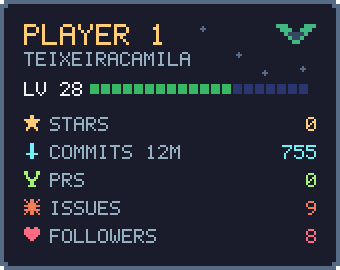
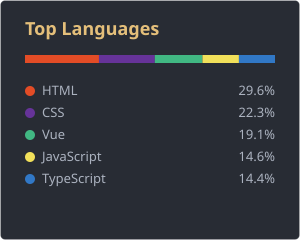

# Hello, I'm Camila! 👋

I'm a **Frontend Developer** passionate about creating intuitive and engaging user interfaces. I specialize in **Vue.js** and love building projects in my free time while continuously exploring new frontend technologies.

## 🚀 About Me

I focus on crafting responsive and dynamic web applications with a strong emphasis on user experience. My main expertise lies in Vue.js, but I'm always eager to learn and experiment with the latest frontend tools and frameworks.

## 💻 Tech Stack

### Frontend Focus
- **Framework:** Vue.js (my specialty!)
- **Languages:** JavaScript, HTML, CSS
- **Styling:** CSS3, Sass, responsive design
- **Tools:** Git, npm, Vite
- **Practices:** Component-based architecture, modern frontend development

## 📊 GitHub Stats

## 🌐 Connect with Me

---

💡 *Building beautiful interfaces, one component at a time!*
